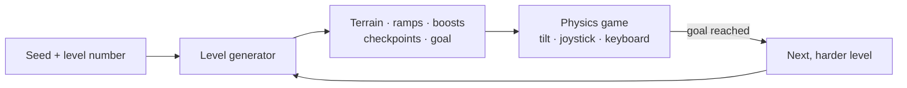

# Ball Odyssey

[![style: very good analysis][very_good_analysis_badge]][very_good_analysis_link]
[![License: MIT][license_badge]][license_link]

A physics platformer where you roll, jump and boost a ball through **infinite, procedurally generated levels** that
keep getting harder. The early levels are a relaxed way to pass the time; the deep ones are a long, demanding
challenge for players who want to see how far they can climb.

Ball Odyssey runs on **Android** and in the **browser**. It is built with Flutter and the Flame game engine, with
Box2D physics.

> The game is being rebuilt around this vision. The current version is a playable baseline; see
> [Product](docs/product.md) for what works today and what is changing.



## Play it locally

You need Flutter 3.47 (stable). Then:

```sh
flutter pub get
# Android (emulator or device)
flutter run --flavor development --target lib/main_development.dart
# Browser
flutter run -d chrome --target lib/main_development.dart
```

Controls: tilt the phone (tilt mode), or use the on-screen joystick and jump button; on a keyboard, `A`/`D` to roll
and `Space` to jump.

## Documentation

| Page | What it covers |
|---|---|
| [Product](docs/product.md) | Vision, players, gameplay today, known gaps and open questions |
| [Architecture](docs/architecture.md) | How the app and game are structured, and the target layering |
| [Development](docs/development.md) | Toolchain, flavors, tests, localization, CI and release signing |
| [Deployment](docs/deployment.md) | The web game on the self-hosted Coolify server: setup, updates, rollback |
| [Glossary](docs/glossary.md) | Domain vocabulary: levels, seeds, difficulty, terrain |
| [Decisions](docs/decisions/) | Architecture decision records (ADRs) |

The ADRs are:

- [ADR-0001](docs/decisions/0001-flame-game-android-web.md): Flame game, Android and web only
- [ADR-0002](docs/decisions/0002-license-mit.md): MIT license
- [ADR-0003](docs/decisions/0003-spec-first-with-openspec.md): spec-first changes with OpenSpec
- [ADR-0004](docs/decisions/0004-languages.md): languages
- [ADR-0005](docs/decisions/0005-layered-architecture.md): layered architecture with key local packages
- [ADR-0006](docs/decisions/0006-box2d-v3-physics.md): Box2D v3 physics
- [ADR-0007](docs/decisions/0007-app-identity.md): app identity
- [ADR-0008](docs/decisions/0008-material-ui.md): Material from `material_ui`
- [ADR-0009](docs/decisions/0009-level-generator-and-movement-envelope.md): level generator bounded by a measured
  movement envelope
- [ADR-0010](docs/decisions/0010-visual-system-and-biomes.md): hybrid visual system with biomes as data
- [ADR-0011](docs/decisions/0011-hud-layout.md): a small HUD in the top corners
- [ADR-0012](docs/decisions/0012-self-hosted-web-on-coolify.md): the web game built and served by Coolify on our own
  server
- [ADR-0013](docs/decisions/0013-demanding-pacing.md): a demanding pace from level 1, everything known by level 8
- [ADR-0014](docs/decisions/0014-new-physics-interleaved.md): curved terrain from level 1, new physics interleaved
  with the logic mechanics

Contributors (human or AI) start with [AGENTS.md](AGENTS.md).

## License

[MIT](LICENSE) © Guillermo Rojo.

[license_badge]: https://img.shields.io/badge/license-MIT-blue.svg
[license_link]: https://opensource.org/licenses/MIT
[very_good_analysis_badge]: https://img.shields.io/badge/style-very_good_analysis-B22C89.svg
[very_good_analysis_link]: https://pub.dev/packages/very_good_analysis
