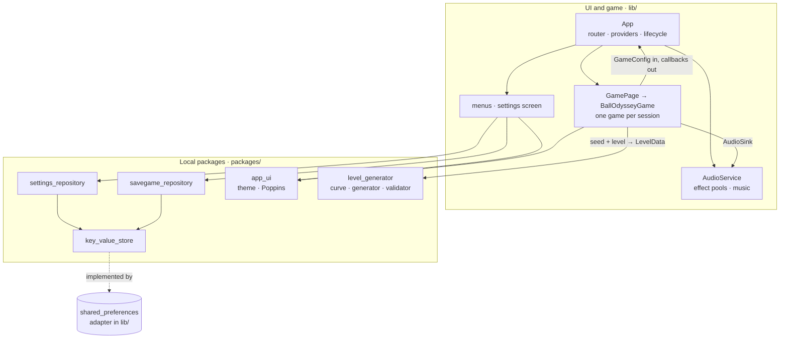

# Architecture

Ball Odyssey is a Flutter app built on Very Good Core with a Flame game inside
([ADR-0001](decisions/0001-flame-game-android-web.md)). Flutter handles menus, settings, routing and persistence;
Flame and Forge2D run the game ([ADR-0006](decisions/0006-box2d-v3-physics.md)). Code is layered with dependencies
pointing inwards, and data and theme live in local packages ([ADR-0005](decisions/0005-layered-architecture.md)).

## App shell

Three flavor entry points call `bootstrap(App.onDevice)`. `App` is stateful and creates, once for the app's lifetime:

- the `GoRouter` (so a language change never restarts navigation);
- the image cache and the `AudioService`;
- `SettingsCubit`, `SavegameCubit` and `PreloadCubit`;
- an `AppLifecycleListener` that pauses and resumes the music.

On start it loads settings and savegames, preloads images and audio, applies the volumes and starts the music. On the
web it retries the music at the first tap or key press, because browsers block audio until then.
`AudioSettingsListener` applies every settings change to the audio service.

| Route | Screen |
|---|---|
| `/loading` | Preload progress, then the menu (or a deep link's target) |
| `/menu` | Title screen: continue, savegames, settings |
| `/savegames`, `/levels` | Savegame list and level selector |
| `/game` | `GamePage`, one play session |
| `/settings` | Music and effects volume, control mode, language; pushed over its caller |

## Game session

`GamePage` creates one `BallOdysseyGame` per visit and owns its focus node:

- it pauses the game, showing the pause menu, when the app goes to the background;
- on dispose it calls `teardown`, which stops the sensor and destroys the native Box2D world. Box2D allows a limited
  number of worlds, so this is required.

The game receives settings as a `GameConfig` value and reports progress through callbacks; it never reads Blocs.

Each level is a single `LevelComponent` under the world, built from the `LevelData` that `GamePage` asks the
generator for, with the savegame's seed. It holds terrain, sensors, the goal and the ball:

- **Terrain:** one static body per floor run, with the tile sprite repeated along it and only the visible tiles
  drawn; ramps, boosts and checkpoints are their own components.
- **Restart and advance:** replace that component in place. Body components destroy their bodies when removed.
- **Falling:** detected in constant time, by comparing the ball with the level's lowest terrain point. The ball
  respawns at rest above the last checkpoint it passed, with any boost cancelled; with no checkpoint, the level
  restarts.
- **The goal:** plays its flash-and-fade sequence on the camera viewport and then completes the level.

Input writes a `MovementIntent` (horizontal push and jump requests) that the ball reads:

- `TiltInput` exists only in tilt mode on Android, and subscribes to the accelerometer only while mounted. It reads
  the tilt relative to the screen: the portrait axis, or in landscape the other axis, signed by the side the phone is
  turned to.
- `ManualInput` handles the joystick and `A`/`D`/`Space`. The joystick and the jump button are sized and placed for
  the thumb from the screen size (`HudLayout`).
- `applyConfig` swaps the two when the setting changes.

Boosts end on a game-time `Timer` owned by the ball, so they pause with the game and vanish with the level.

## Camera

`CameraController` (`lib/game/camera/`) is plain math: each frame the game gives it the ball's position and velocity,
and copies the centre and zoom it returns into the viewfinder.

- **Framing:** it zooms so that at least 16 m × 9 m is visible in landscape and 12 m across in portrait, with the
  ground at about 65 % of the screen height.
- **Look-ahead:** it looks further ahead the faster the ball moves.
- **Ground following:** it follows the highest ground under and just ahead of the ball, found by binary search over
  the sorted terrain, not the ball's bounces, and keeps the ball between 15 % and 85 % of the screen height.
- **Anticipated zoom:** it zooms out about 1.2 s before the ball reaches a boost, and at high speed.
- **Smoothing:** every value moves with a critically damped spring solved exactly, so the view never overshoots and
  behaves the same at any frame rate.
- **Snapping:** a new level, a respawn or a screen rotation re-frames at once.

## Level generation

`packages/level_generator` turns a seed and a level number into `LevelData`, the same on every platform
([ADR-0009](decisions/0009-level-generator-and-movement-envelope.md)):

1. `DifficultyCurve` maps the level number to `LevelParameters`: stage, breather, intensity, safety margin, obstacle
   share, target duration, checkpoint spacing and section weights.
2. `LevelGenerator` walks a cursor from the start platform to the goal and appends sections until the estimated
   duration reaches the target. Each gap and climb is sized from the speed the player can have there, within the
   `MovementEnvelope` times the margin. Checkpoints go at the start of a floor run once enough time has passed since
   the last respawn point.
3. `LevelValidator` re-checks a level independently: geometry, ramp joins, and every gap and climb against the
   envelope.

The game's `ballEnvelope` (`lib/game/ball_envelope.dart`) holds the numbers measured with the real physics. Two game
tests keep them honest: `movement_envelope_test.dart` drives the real ball and fails if the physics stops reaching
them, and `level_playthrough_test.dart` has a bot play one level per stage plus two deep levels.

## Audio

`AudioService` keeps three low-latency players per effect, used in turn, and one looping music player, through an
`AudioBackend` that tests replace with a fake. It computes volumes from the settings (music, effects, mute) and
preloads into the global `audioplayers` cache that playback reads. The shipped files are made reproducibly by
`tool/audio/process.sh` (see [Development](development.md#audio-assets)).

## Packages

| Package | Kind | Role |
|---|---|---|
| `key_value_store` | Dart | `KeyValueStore` interface and an in-memory implementation |
| `settings_repository` | Dart | `PlayerSettings` with per-field validation and legacy key migration |
| `savegame_repository` | Dart | `SavedGame` list in the stored JSON format; progress never goes back |
| `app_ui` | Flutter | `AppTheme.dark`, `AppColors`, bundled Poppins and its license |
| `level_generator` | Dart | Deterministic levels: PRNG, difficulty curve, movement envelope, generator, validator |

The app's `SharedPreferencesKeyValueStore` uses the legacy `SharedPreferences` API on purpose, so data stored by
earlier versions stays readable on Android.

| Path | Role |
|---|---|
| `lib/app/` | `App`, `AppView`, `router.dart` (`AppRoutes`) |
| `lib/audio/` | `AudioService`, backend, settings listener |
| `lib/game/` | Game, level and ball components, inputs, `CameraController`, `ballEnvelope`, `GamePage`, pause menu |
| `lib/settings/` | `SettingsCubit` and the settings screen |
| `lib/loading/`, `lib/title/` | Preload screen, menu, savegame and level selectors |
| `lib/shared/` | `SavegameCubit`, storage adapter, shared widgets |
| `lib/l10n/` | ARB files and the `context.l10n` extension; generated code in `lib/l10n/gen/` |
| `lib/gen/` | Asset paths generated by FlutterGen |
