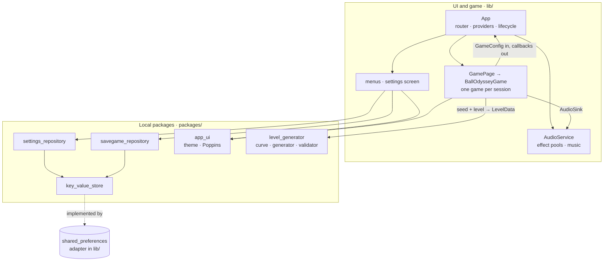

# Architecture

Ball Odyssey is a Flutter app built on Very Good Core with a Flame game inside
([ADR-0001](decisions/0001-flame-game-android-web.md)). Flutter handles menus, settings, routing and persistence;
Flame and Forge2D run the game ([ADR-0006](decisions/0006-box2d-v3-physics.md)). Code is layered with dependencies
pointing inwards, and data and theme live in local packages ([ADR-0005](decisions/0005-layered-architecture.md)).

## App shell

Three flavor entry points call `bootstrap(App.onDevice)`. `App` is stateful and creates, once for the app's lifetime:

- the `GoRouter` (so a language change never restarts navigation);
- the image cache and the `AudioService`;
- `SettingsCubit`, `SavegameCubit` and `PreloadCubit`;
- an `AppLifecycleListener` that pauses and resumes the music.

On start it loads settings and savegames, preloads images and audio, applies the volumes and starts the music. On the
web it retries the music at the first tap or key press, because browsers block audio until then.
`AudioSettingsListener` applies every settings change to the audio service.

| Route | Screen |
|---|---|
| `/loading` | Preload progress, then the menu (or a deep link's target) |
| `/menu` | Title screen: continue, savegames, settings |
| `/savegames`, `/levels` | Savegame list and level selector |
| `/game` | `GamePage`, one play session |
| `/settings` | Music and effects volume, control mode, language; pushed over its caller |

## Game session

`GamePage` creates one `BallOdysseyGame` per visit and owns its focus node:

- it pauses the game, showing the pause menu, when the app goes to the background;
- on dispose it calls `teardown`, which stops the sensor and destroys the native Box2D world. Box2D allows a limited
  number of worlds, so this is required.

The game receives settings as a `GameConfig` value and reports progress through callbacks; it never reads Blocs.

Each level is a single `LevelComponent` under the world, built from the `LevelData` that `GamePage` asks the
generator for, with the savegame's seed. It holds terrain, sensors, the goal and the ball:

- **Terrain:** one static body per floor run, painted with the world's generated textures (see Visuals); ramps,
  boosts and orbs (one `BoostComponent` per type), checkpoints and the goal are their own components.
  `CurvedTerrainComponent` makes each hill, half-pipe or rounded slope one static chain with ghost vertices, so the
  ball never catches on a seam. Every floor run's top is a chain whose ghost ends continue level, with its box just
  below, so a fast ball rolls across a seam with the next run or a curve, and lands on an edge, without catching on a
  box's corner. A chain reports a contact per segment, so the ball counts the shapes it touches per surface.
- **Mechanics:** `SpikeComponent` is a sensor inset by the ball's radius, so a strip is as wide to clear as a gap.
  `MovingPlatformComponent` is a kinematic body. It hands its changes of velocity to the ball on its deck, and the
  ball's damping acts relative to the deck, so the ball rests and rolls on it as on the ground. `CrumblingPlatformComponent` is a floor that stops supporting the ball when it collapses. Grounding
  goes through `GroundSurface`, which every floor, ramp and curve implements, and which also tells the ball what the
  surface is made of: on ice its push and damping are weaker, mud damps it harder and weakens the jump, and a belt
  damps it relative to the belt's speed. `TrampolineComponent` is a sensor that sets the ball's upward speed to a
  fixed value. `AdrenalineZoneComponent` is a sensor over a tense stretch: while the ball is in it, its push is
  stronger; `RushTrailComponent` draws its trail and `AdrenalineGlowComponent`, in the viewport, the red pulse at the
  screen's edges. `LoopComponent` is two one-sided, frictionless arcs that take turns through their collision filters,
  so the way in and the way out can cross at the foot; inside, the ball's push and damping are suspended.
- **Restart and advance:** replace that component in place. Body components destroy their bodies when removed.
- **Falling:** a fall is detected once no ground is left below the ball that it could still reach: `LevelComponent`
  keeps the lowest ground of every 2 m column, curves included, and checks, while the ball is in the air, whether any lies within the
  sideways reach of its fall ([ADR-0013](decisions/0013-demanding-pacing.md)). The level's lowest point is a backstop.
  Laser barriers (`LaserBarrierComponent`) light and darken on their own clock. A fall, spikes and a lit laser
  share `LevelComponent.sendBack()`: the ball respawns at rest above the last checkpoint it passed, with any
  boost and orb charge cancelled, and crumbled islands, collected orbs and loops' tracks come back; with no
  checkpoint, the level restarts.
- **The goal:** plays its flash-and-fade sequence on the camera viewport and then completes the level.

The HUD lives in the camera viewport ([ADR-0011](decisions/0011-hud-layout.md)). `CheckpointTrackComponent` and
`BoostTrayComponent` read the level's checkpoints and the ball's `activeBoost`, `boostLeft` and `hasAirJump` every
frame and keep no state of their own, so restarts need no wiring. `PickupMessageComponent` shows a short message over
the ball when the level reports an orb or a checkpoint; its text comes translated through the game's `hudLabel`
callback. `HudLayout` sizes every piece from the screen's shorter side.

Input writes a `MovementIntent` (horizontal push and jump requests) that the ball reads:

- `TiltInput` exists only in tilt mode on Android, and subscribes to the accelerometer only while mounted. It reads
  the tilt relative to the screen: the portrait axis, or in landscape the other axis, signed by the side the phone is
  turned to. It samples at the game interval, and a quick flick (z leaving its slowly following baseline) requests a
  jump, once per flick.
- `ManualInput` handles the joystick and `A`/`D`/`Space`. The joystick and the jump button are sized and placed for
  the thumb from the screen size (`HudLayout`).
- `applyConfig` swaps the two when the setting changes.

Boosts end on a game-time `Timer` owned by the ball, so they pause with the game and vanish with the level.

The world's gravity is 12 m/s² (`BallOdysseyGame.gravity`), with the launches compensated so jumps keep their heights.
The ball allows fast rotation, since Box2D otherwise caps a rolling ball near 9.3 m/s, and never sleeps.

## Visuals

`lib/game/visuals/` holds the visual system ([ADR-0010](decisions/0010-visual-system-and-biomes.md)):

- `WorldLook` derives the world, biome and variant from the seed and level number, and `BiomePalette` holds each
  biome's colors.
- `TerrainTextures` draws a body and a surface texture per world when a level loads, cached for the last two looks;
  `TerrainPaint` paints floors and ramps with them through repeating image shaders anchored in world coordinates.
- `BiomeBackdrop` draws the sky, three cached silhouette layers and the parallax for the generated biomes;
  `ParticleField` adds ambient particles; the night forest keeps the painted `ParallaxComponent`.
- `ElementPalette` and `ElementPainter` give boosts, checkpoints and the goal fixed colors and depth: a shadow, a
  glow, a lit body, and a dark outline with a light rim.

## Camera

`CameraController` (`lib/game/camera/`) is plain math: each frame the game gives it the ball's position and velocity,
and copies the centre and zoom it returns into the viewfinder.

- **Framing:** it zooms so that at least 16 m × 9 m is visible in landscape and 12 m across in portrait, with the
  ground at about 65 % of the screen height.
- **Look-ahead:** it looks further ahead the faster the ball moves.
- **Ground following:** it follows the highest ground under and just ahead of the ball, found by binary search over
  the sorted terrain, not the ball's bounces, and keeps the ball between 15 % and 85 % of the screen height.
- **Anticipated zoom:** it zooms out about 1.2 s before the ball reaches a boost, at high speed, and while the ball
  is far above the ground, so the ground stays in view.
- **Loops:** while the ball rides through a loop, the view blends onto the loop's centre, so it does not follow each
  turn.
- **Smoothing:** every value moves with a critically damped spring solved exactly, so the view never overshoots and
  behaves the same at any frame rate.
- **Snapping:** a new level, a respawn or a screen rotation re-frames at once.

## Level generation

`packages/level_generator` turns a seed and a level number into `LevelData`, the same on every platform
([ADR-0009](decisions/0009-level-generator-and-movement-envelope.md)):

1. `DifficultyCurve` maps the level number to `LevelParameters`: stage, breather, intensity, depth, precision,
   obstacle share, target duration, checkpoint spacing, section weights scaled by depth, and the chances of break
   points and adrenaline rushes, with each element introduced at its level.
2. `LevelGenerator` walks a cursor from the start platform to the goal and appends phrases until the estimated
   duration reaches the target: rests, flow phrases of sections taken without stopping that may end in a break point,
   and challenge phrases, some of them adrenaline zones. Each gap, climb, spike strip and boosted section is a share of the reach from the
   precision interval. The reach comes from the speed the player can have there, read on the measured speed curve.
   The speed estimate stays honest:
   - landings cap it, since a player braking in the air to land comes down slower;
   - ramps down and cascades cap it like drops;
   - speed boosts add their measured gain to it;
   - each surface reads its own speed curve, and gaps and climbs from mud use the mud jump;
   - after a curve or a loop it is the speed a pushing ball is measured to leave at;
   - in an adrenaline zone it reads the plain curve scaled by the rush's gain;
   - a checkpoint resets it to what a player builds after a respawn.
   Curves are exact polynomials, sampled every half meter at most, so they are the same on every platform.
   Checkpoints go at the start of a floor run once enough time has passed since the last respawn point.
3. `LevelValidator` re-checks a level independently: geometry, ramp and curve joins, spikes, ferries, crumbling
   islands, orbs, trampolines, surfaces, loops, and every gap and climb against the envelope.

The game's `ballEnvelope` (`lib/game/ball_envelope.dart`) holds the numbers measured with the real physics, the
speed curve included. Two game tests keep them honest: `movement_envelope_test.dart` drives the real ball and fails if
the physics stops reaching them, and `level_playthrough_test.dart` has a bot (`test/helpers/level_bot.dart`) play one
level per introduction plus deep levels. The bot takes off near edges, holds a steady push in the air, rides ferries,
uses orbs, keeps pushing over curves and through loops, steers after a trampoline's bounce or a jump boost, pushes
harder in a rush, and jumps off a ledge over spikes just below. Before tuning the
curve, run a local stress run of a few hundred levels with the same bot. Box2D allows only so many worlds in one test
process, so keep each stress file under about 120 levels.

## Audio

`AudioService` keeps three low-latency players per effect, used in turn, and one looping music player, through an
`AudioBackend` that tests replace with a fake. It computes volumes from the settings (music, effects, mute) and
preloads into the global `audioplayers` cache that playback reads. The shipped files are made reproducibly by
`tool/audio/process.sh` (see [Development](development.md#audio-assets)).

## Haptics

Like audio, the game only reports events to a `HapticsSink`: `jump` (an effective jump), `boost` and `checkpoint`.
`DeviceHaptics` (`lib/haptics/`) turns them into Flutter's `HapticFeedback`:

| Event | Feedback |
|---|---|
| `jump` | a light pulse |
| `boost` | a heavy pulse |
| `checkpoint` | two medium pulses 120 ms apart |

It reads the vibration setting on every event, so a change applies at once. On the web, `GamePage` passes `NoHaptics`.

## Packages

| Package | Kind | Role |
|---|---|---|
| `key_value_store` | Dart | `KeyValueStore` interface and an in-memory implementation |
| `settings_repository` | Dart | `PlayerSettings` with per-field validation and legacy key migration |
| `savegame_repository` | Dart | `SavedGame` list in the stored JSON format; progress never goes back |
| `app_ui` | Flutter | `AppTheme.dark`, `AppColors`, bundled Poppins and its license |
| `level_generator` | Dart | Deterministic levels: PRNG, difficulty curve, movement envelope, generator, validator |

The app's `SharedPreferencesKeyValueStore` uses the legacy `SharedPreferences` API on purpose, so data stored by
earlier versions stays readable on Android.

| Path | Role |
|---|---|
| `lib/app/` | `App`, `AppView`, `router.dart` (`AppRoutes`) |
| `lib/audio/` | `AudioService`, backend, settings listener |
| `lib/game/` | Game, level and ball components, inputs, `CameraController`, `ballEnvelope`, `GamePage`, pause menu |
| `lib/settings/` | `SettingsCubit` and the settings screen |
| `lib/loading/`, `lib/title/` | Preload screen, menu, savegame and level selectors |
| `lib/shared/` | `SavegameCubit`, storage adapter, shared widgets |
| `lib/l10n/` | ARB files and the `context.l10n` extension; generated code in `lib/l10n/gen/` |
| `lib/gen/` | Asset paths generated by FlutterGen |
