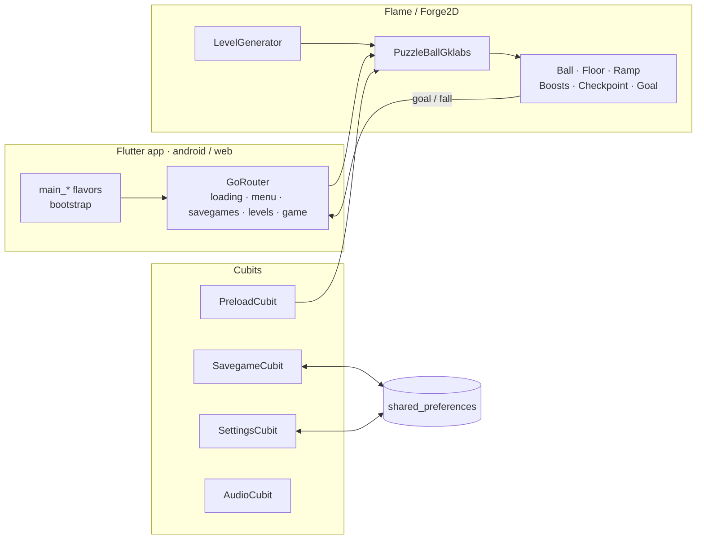
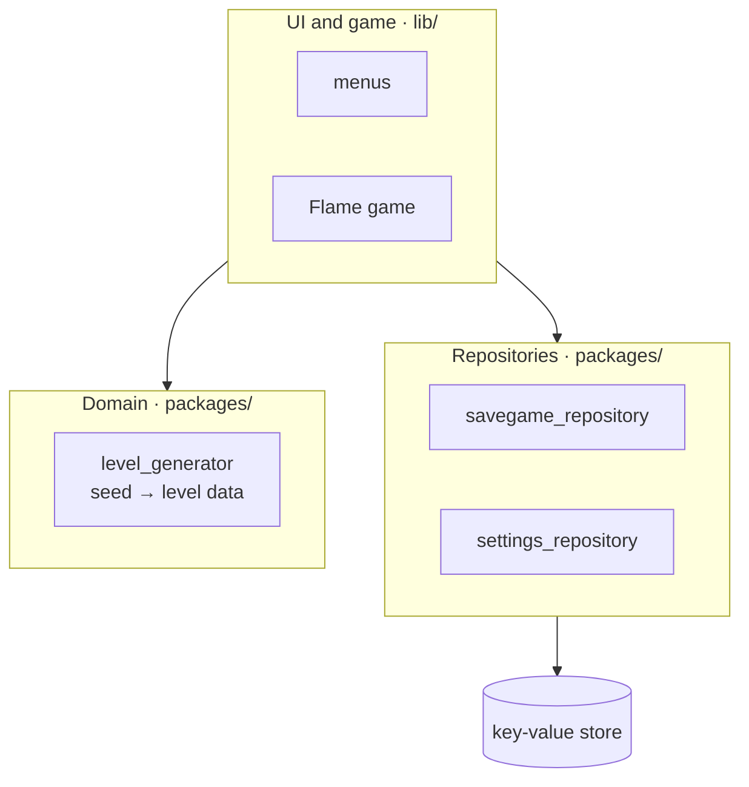

# Architecture

Ball Odyssey is a Flutter app built on Very Good Core with a Flame game inside
([ADR-0001](decisions/0001-flame-game-android-web.md)). Flutter handles menus, routing and persistence; Flame and
Forge2D run the game ([ADR-0006](decisions/0006-box2d-v3-physics.md)).

## Today (baseline)

Three flavor entry points share one `bootstrap`, which installs a `BlocObserver` and a `FlutterError` hook and runs
`App`. `App` provides four Cubits and routes with `go_router`:

- `/loading`: preloads images and audio into Flame caches (`PreloadCubit`);
- `/menu`: title screen over a parallax background, control mode, language and sound;
- `/savegames`: create, continue or delete savegames (`SavegameCubit`);
- `/levels`: grid of unlocked levels of a savegame;
- `/game`: builds the level list and runs `PuzzleBallGklabs`, a `Forge2DGame`.

| Path | Role |
|---|---|
| `lib/main_<flavor>.dart`, `lib/bootstrap.dart` | Entry points and cross-flavor setup |
| `lib/app/` | Root widget, providers and router |
| `lib/loading/`, `lib/title/` | Preload screen, menu, savegame and level selectors |
| `lib/game/` | The Flame game: components, levels, camera helpers, audio Cubit, game page |
| `lib/shared/` | Savegame and settings Cubits, theme, shared widgets |
| `lib/l10n/` | ARB files and the `context.l10n` extension |
| `lib/gen/` | Asset paths generated by FlutterGen |

## Target layering

The rebuild moves to layers with dependencies pointing inwards
([ADR-0005](decisions/0005-layered-architecture.md)):

- `level_generator` is pure Dart: it turns a seed and a level number into level data (terrain, boosts, checkpoints,
  goal) and owns the difficulty curve. The game only renders and simulates what it receives.
- The game receives settings (control mode, sound) as values and reports events (level completed, fell) through
  callbacks; it never reads Blocs from `game.buildContext`.
- `app_ui` holds the theme and bundled fonts.
